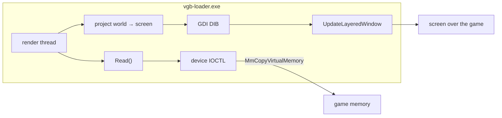

# 09 — In-game overlay

The overlay is the part that proves the whole chain works. It draws **your** position, **your attack range**, and enemy heroes with health and distance, over the live game — and it needs no injection, because every number it draws comes through the driver device.

---

## 1. What it is

A click-through, topmost, per-pixel-alpha layered window owned by `vgb-loader.exe`, positioned over the game client's window.

| Property | Value | Why |
|----------|-------|-----|
| `WS_EX_LAYERED` + `UpdateLayeredWindow` | per-pixel alpha | transparent background, no black box |
| `WS_EX_TRANSPARENT` | click-through | mouse input still reaches the game |
| `WS_EX_TOPMOST` | above the game | survives the game repainting |
| `WS_EX_TOOLWINDOW` | no taskbar button | it is not an app |
| `WS_EX_NOACTIVATE` | never steals focus | typing in game is unaffected |
| GDI + 32-bit DIB | drawing | no DirectX device, no hook, no injection |
| F9 | hotkey | stops it from anywhere |

---

## 2. Data flow



There is no hook, no injected DLL, and no D3D present call. The overlay is a separate topmost window that happens to sit over the game.

---

## 3. Start it

From the menu (`o`), or from the CLI:

```powershell
.\dist\vgb-loader.exe overlay <pid>
```

The CLI form blocks until F9, because the render thread dies with the process.

---

## 4. What it draws

| Element | Meaning |
|---------|---------|
| green box + `YOU hp/maxhp` | you |
| cyan ring around you | your attack range (550 units) |
| blue box | ally hero |
| red box | enemy hero |
| health bar above each box | current health fraction |
| `name Llevel distance` above each box | identity and range |
| thin line from you to each hero | who is in range of what |
| top-left status block | pid, base, fps, hero count, matrix/self state |

If the status block says `matrix MISSING` or `self null`, the overlay is running but the offsets are not resolving — see §6.

---

## 5. How positions become pixels

The game's view matrix (world → clip) is read through the device, then the standard divide:

```
screen.x = (width  / 2) * (1 + clipX / clipW)
screen.y = (height / 2) * (1 - clipY / clipW)
```

Any point with `clipW <= 0` is behind the camera and is dropped, as is any non-finite result. The attack-range ring is 64 points around you in world space, each projected and the valid neighbours joined — so the ring curves correctly in perspective instead of being a circle drawn in screen space.

---

## 6. When it draws nothing

| Symptom | Cause |
|---------|-------|
| `heroes 0`, `self null` | not in a match — the object graph is null between games |
| `matrix MISSING` | the view-matrix offset moved on a patch |
| boxes in the wrong place | position or matrix offset is stale |
| nothing at all, no window | game window not found; the overlay needs the client running |
| window appears but is black | DIB creation failed — check the log |

The offsets are duplicated in `loader/overlay.cpp` from `scripts/offsets.py`. **Re-distil both together.** The overlay is a fast, dumb renderer; the Python side is where offsets are tracked and verified.

---

## 7. Performance

- One IOCTL per field read. A full frame is roughly `3 + 8n` calls, capped at `MAX_OBJECTS` (1024).
- 30 fps target (`Sleep(33)`); it is a status view, not a 240 Hz renderer.
- The DIB is only recreated when the client size changes.
- Alpha is stamped by OR-ing `0xFF000000` into every non-black pixel, because GDI leaves alpha at 0 and a layered window would otherwise show nothing.

---

## 8. Limits, stated plainly

- **Read-only.** It never writes, so it cannot desync the game.
- **No ESP for out-of-vision enemies.** `HeroVisible` is respected; fog-of-war entries are skipped.
- **Attack range is a constant**, not read from the hero — level and item modifiers are ignored.
- **No input, no aimbot.** It draws; it does not act.
- **x64 Windows 10/11 only**, like the rest of the project.
- **Offsets are unverified.** Expect to correct them on the first run.

---

Back to [index](README.md)
