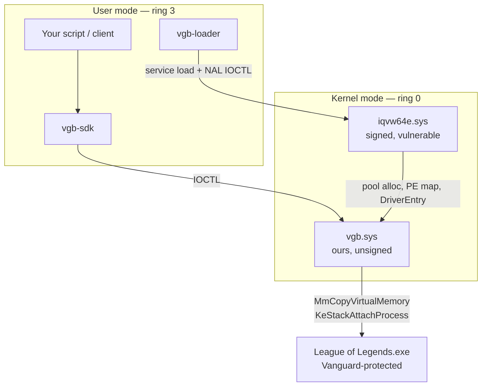

# VanguardBypass for League of Legends — Engineering Documentation

This documentation explains **what every component does, why it exists, and exactly how data moves between them**. Read it in order the first time; it is written so that each document builds on the previous one.

> Scope: this is a kernel-assisted external memory interface for League of Legends. It does not inject into the game and it does not touch the Vanguard driver itself. It restores the ability to read and write game memory from a normal user-mode process, which Vanguard otherwise removes.

---

## Read in this order


| # | Document | What it answers |
|---|----------|-----------------|
| 01 | [Architecture](01-architecture.md) | What are the pieces, who talks to whom, where is the trust boundary |
| 02 | [Detection model](02-vanguard-detection-model.md) | What Vanguard actually does, and which countermeasure covers which mechanism |
| 03 | [Component flows](03-component-flows.md) | Step-by-step sequence for load, read, write, hide, unload, and how each one fails |
| 04 | [Build and load](04-build-and-load.md) | Toolchain, build graph, artifact table, and the load-path matrix for Secure Boot / HVCI |
| 05 | [API reference](05-api-reference.md) | Every IOCTL, every struct, every status code, C++ and Python usage |
| 06 | [Troubleshooting](06-troubleshooting.md) | Decision trees for each failure mode |
| 07 | [Production checklist](07-production-checklist.md) | What is done, what is genuinely still missing, and in what order |
| 08 | [Scripting](08-scripting.md) | How a script reads memory without a handle, and how offsets are managed |
| 09 | [Overlay](09-overlay.md) | The in-game renderer: what it draws, how projection works, when it draws nothing |

---

## 60-second summary

Vanguard registers an object callback (`ObRegisterCallbacks`) and, for every handle another process opens to the game, **strips `PROCESS_VM_READ`, `PROCESS_VM_WRITE` and `PROCESS_VM_OPERATION`**. An external tool therefore cannot `OpenProcess` + `ReadProcessMemory` the game. This project restores that access from kernel mode in two independent ways and adds module hiding so injected code is not enumerated.



---

## Quick start (once the loader is built)

```powershell
# 1. Elevated shell required — driver loading needs SeLoadDriverPrivilege
.\dist\vgb-loader.exe load

# 2. Resolve the game and pin our client process for handle restoration
.\dist\vgb-loader.exe pid League of Legends.exe
.\dist\vgb-loader.exe attach --client (Get-Process vgb-loader).Id

# 3. Use it
.\dist\vgb-loader.exe base <pid> League of Legends.exe
.\dist\vgb-loader.exe read <pid> <address> 64
```

---

## Repository layout

```
 driver/    kernel driver — the actual bypass
 loader/    user-mode mapper: loads vgb.sys through the signed NAL driver
 sdk/       client library (C++ header + Python ctypes binding)
 client/    reference client
 build/     compiler output
 dist/      shippable layout (loader, sdk, drivers, docs)
 docs/      this documentation
 research/  primary sources the design is based on
 tools/     maintenance utilities
```

---

## Terminology

| Term | Meaning |
|------|---------|
| **Vanguard / vgk** | Riot's kernel anti-cheat. `vgk.sys` is a boot-start driver, so it is always resident before any user process. |
| **Object callback** | `ObRegisterCallbacks` hook that runs on every handle create/duplicate. Vanguard uses it to remove access rights. |
| **Attach-based copy** | `KeStackAttachProcess` + `MmCopyVirtualMemory`. Copies memory against the `EPROCESS` directly, so no handle and no access mask are involved. |
| **Manual mapping** | Loading a PE by hand (allocate, relocate, resolve imports, call entry) instead of `NtLoadDriver`. Required because our driver is unsigned. |
| **NAL driver** | `iqvw64e.sys`, an Intel-signed diagnostic driver with a broad kernel read/write/execute primitive. Used as the mapping host. |
| **LDR unlink** | Removing a module from the PEB's three loader lists so `Module32First`/PEB walks no longer report it. |
