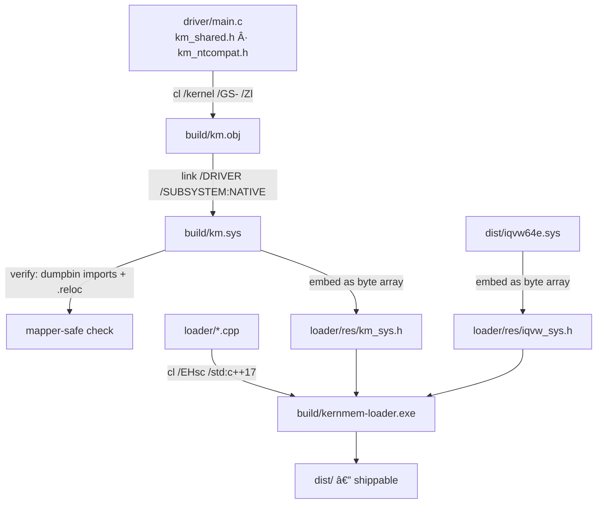
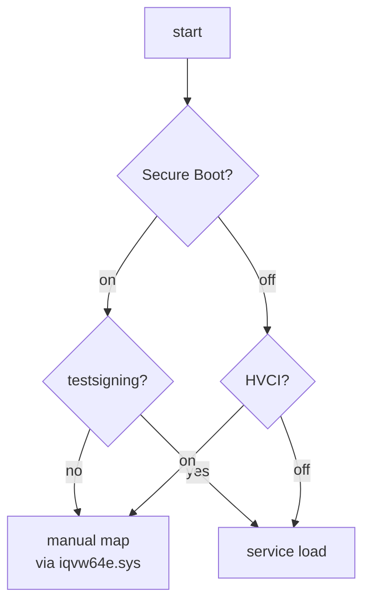

# 04 — Build and load

## 1. Toolchain requirements

| Requirement | Version used | Why |
|-------------|--------------|-----|
| MSVC | 14.44 (`/vcvars64`) | compiles kernel C |
| Windows SDK | 10.0.26100.0 | `um` headers for the loader |
| WDK | 10.0.26100.0 | `km` headers, `ntoskrnl.lib` |
| PowerShell | 5.1 | build orchestration |

Verify before building:

```powershell
Test-Path 'C:\Program Files (x86)\Windows Kits\10\Include\10.0.26100.0\km\wdm.h'
Test-Path 'C:\Program Files (x86)\Windows Kits\10\Lib\10.0.26100.0\km\x64\ntoskrnl.lib'
Test-Path 'C:\Program Files\Microsoft Visual Studio\2022\Community\VC\Auxiliary\Build\vcvars64.bat'
```

All three must be `True`. `driver/build.ps1` throws with the exact missing path otherwise.

---

## 2. Build graph



Build order is not optional: `km.sys` must exist and pass the safety check before its bytes can be embedded, and the loader cannot link before the resource headers exist.

The generated headers are **committed**, so a fresh clone can build the loader without first building the driver. That creates a staleness risk, which is closed by a hash guard: `tools/embed.ps1` stamps the source SHA-256 into each header as `#define <symbol>_SHA256 "..."`, and `loader/build.ps1` refuses to link when that value does not match `build/km.sys`. The check is skipped when `build/km.sys` is absent, which is exactly the fresh-clone case, so a clone is never blocked by it. Timestamps are not used — a clone stamps every file with clone time.

---

## 3. Compile and link flags, and why each one

### Compiler (`cl`)

| Flag | Reason |
|------|--------|
| `/kernel` | kernel-mode semantics, no user CRT assumptions |
| `/GS-` | no stack-cookie initialiser — manual mapping never runs it |
| `/Zl` | omit default-library record so nothing implicitly links |
| `/D_AMD64_` | the WDK build system normally supplies this; `ntdef.h` hard-errors without it |
| `/D_KERNEL_MODE` | switches `km_shared.h` to `ntdef.h` instead of `windows.h` |
| `/O2` | size and speed |
| `/W3` | warnings on; the build is currently warning-clean apart from the reserved-macro note |

### Linker (`link`)

| Flag | Reason |
|------|--------|
| `/DRIVER` | driver image, not EXE |
| `/SUBSYSTEM:NATIVE` | no subsystem entry |
| `/ENTRY:DriverEntry` | explicit, since there is no CRT stub |
| `/OPT:REF /OPT:ICF` | drop unreferenced and identical code |
| `ntoskrnl.lib` only | the single allowed import provider |

### What the build must never do

- Link `libcmt` / `msvcrt` — the CRT is not initialised under manual mapping.
- Use `/GS` — the cookie would be read before `__security_init_cookie` runs.
- Emit a `.pdata`-less image — `__try/__except` needs it.

---

## 4. Mapper-safety verification

Every build must pass this before packaging:

```powershell
dumpbin /imports /relocations build\km.sys
```

| Check | Pass condition |
|-------|----------------|
| Import provider | `ntoskrnl.exe` only — no `HAL.dll`, no CRT |
| `.reloc` section | present, non-empty (manual mapping relocates the image) |
| Entry point | `DriverEntry`, resolvable |
| No `/GS` cookie | `__security_cookie` absent from imports and relocations |

Current state: imports are `ntoskrnl.exe`-only, one `.reloc` entry, no CRT, `.pdata` present. **Passes.**

---

## 5. Load-path matrix

| Secure Boot | HVCI | Test signing | `NtLoadDriver` works | Manual map works | Path taken |
|-------------|------|--------------|----------------------|------------------|------------|
| off | off | any | yes | yes | service load (simplest) |
| off | on | any | yes* | yes | service load, *if signed or HVCI permissive |
| **on** | off | off | **no** | **yes** | **manual map** ← reference machine |
| on | on | off | no | yes | manual map |
| on | off | on | yes | yes | service load or manual map |

Reference machine measured state: `UEFISecureBootEnabled = 1`, `SecurityServicesRunning = {0}` (HVCI off), no `testsigning` in boot options, build 26200. That is row 3 — manual map is the only path.



---

## 6. Artifact table

| Artifact | Source | Committed | Ships | Purpose |
|----------|--------|-----------|-------|---------|
| `build/km.sys` | `driver/main.c` | no | no (embedded) | intermediate only |
| `loader/res/km_sys.h` | generated | **yes** | no | byte array of the above, hash-stamped |
| `loader/res/iqvw_sys.h` | `dist/iqvw64e.sys` | **yes** | no | byte array of the mapping host |
| `dist/iqvw64e.sys` | Intel, extracted | **yes** | **yes** | signed mapping host |
| `dist/kernmem-loader.exe` | `loader/*.cpp` | **yes** | **yes** | the product |
| `dist/kernmem-league.exe` | `league/client/` | **yes** | **yes** | end-to-end smoke test |
| `dist/kernmem-cs2.exe` | `cs2/client/` | **yes** | **yes** | reference client for adding a game |
| `dist/sdk/` | `sdk/` | **yes** | **yes** | client API |
| `dist/docs/` | `docs/` | **yes** | **yes** | this set |

`km.sys` is embedded, not shipped loose, so a user cannot accidentally load the wrong build against a stale loader. The embedded headers are committed for buildability, and the hash guard above keeps them honest.

---

## 7. Elevated requirement

Loading needs `SeLoadDriverPrivilege`, which needs an elevated token. The current shell is **not** elevated.

```powershell
# detect
([Security.Principal.WindowsPrincipal][Security.Principal.WindowsIdentity]::GetCurrent()).IsInRole([Security.Principal.WindowsBuiltInRole]::Administrator)

# relaunch elevated
Start-Process powershell -Verb RunAs -ArgumentList '-NoExit','-Command','cd "' + $PWD + '"; .\dist\kernmem-loader.exe load'
```

Once loaded, the **client does not need elevation** — the device DACL allows any interactive user, and the driver acts with kernel authority.

---

## 8. Reproducible build

```powershell
.\build.ps1            # driver → verify → embed → loader → dist
.\build.ps1 -SkipDriver # loader only, reuses existing km.sys
.\build.ps1 -Clean      # wipe build/ and dist/
```

A build is only "green" when `dist/kernmem-loader.exe` exists **and** `build\km.sys` passed §4.

---

Next: [05 API reference](api-reference.md)
