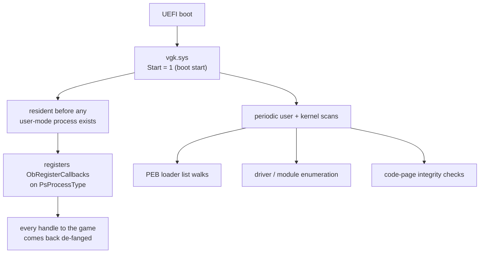
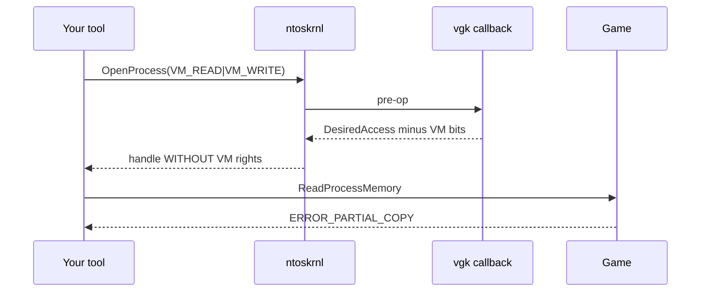

# 02 — What Vanguard actually does, and what covers it

This document is the **threat model**. Every countermeasure in this project exists because of a specific mechanism listed here. Read it before changing the driver, because the mapping table at the end tells you which capability you would lose.

---

## 1. Vanguard's position



`vgk.sys` is a boot-start driver. It is in memory before anything of ours, so **anything it does not like can be acted on before our code runs**. On the reference machine: `Start = 1`, service `vgk`, 113 MB image, HVCI off, Secure Boot on.

---

## 2. The core mechanism: handle stripping

Van1338 documents this precisely. Vanguard registers an object callback on `PsProcessType` and, in the pre-operation handler for `OB_OPERATION_HANDLE_CREATE`, removes the memory rights from the requested access mask:

```c
DesiredAccess &= ~(PROCESS_VM_READ | PROCESS_VM_WRITE | PROCESS_VM_OPERATION);
```

Consequence, stated plainly: **`OpenProcess(PROCESS_VM_READ)` succeeds but the returned handle cannot read.** `ReadProcessMemory` then fails with `ERROR_PARTIAL_COPY`. This is why every external-only approach dies at step one.



---

## 3. Mechanism table

| # | Mechanism | What it observes | Our countermeasure | Where |
|---|-----------|------------------|--------------------|-------|
| 1 | Object callback strips VM rights | access masks on handles to the game | **attach-based copy** — no handle at all | `KmHandleRead` / `KmHandleWrite` via `MmCopyVirtualMemory` |
| 2 | Same callback, same masks | your process's `OpenProcess` calls | **own callback above Vanguard's** re-ORs the bits for the registered PID | `KmProcessPreOperation`, altitude seeded per install (330000-390000) |
| 3 | `SystemModuleInformation` enumeration | loaded drivers | **manual mapping** — no `PsLoadedModuleList` entry, no service key | loader `pe.cpp` + `mapper.cpp` |
| 4 | PEB list walk, LDR name hash, `LdrpModuleIndex` resolve | injected DLLs | **LDR unlink** of all three lists, the `LdrpHashTable` bucket, **and** the by-name index tree (node offset and tree key recovered at runtime, validated before any write) | `KmSetModuleHidden`, `KmUnlinkModuleIndex` |
| 5 | `NtQueryVirtualMemory` / region walks | foreign allocations | allocate inside the game with the game's own `VirtualAllocEx`, not from our process | client-side |
| 6 | Code-page hashing | patches to game `.text` | we do not patch the game; read/write only | by design |
| 7 | Driver-object enumeration | `\Device\` names | name is random per install, and the driver object carries a matching `DriverName` | reduced, not hidden |
| 8 | Handle-table scan for the device | our open device handle | unavoidable with a device; a random name weakens it as a signature | not hidden |

Rows 7 and 8 are reduced, not closed. See §6.

---

## 4. Altitude is the load-bearing detail

Object callbacks run in **descending altitude order** on the way in (pre-operation) and ascending on the way out. To add rights *after* Vanguard removed them, our pre-op must run **after** Vanguard's pre-op, which means a **higher altitude number**.

```
pre-op chain (descending altitude)
  330000  ...
  321000  km.sys   ← adds VM bits back
  320000  vgk.sys   ← removes VM bits
  300000  ...
            ↓
        mask handed to ntoskrnl
```

If our altitude were lower than Vanguard's, Vanguard would strip the bits we just added and Path B would silently do nothing while Path A kept working — a confusing failure. `321000` sits above Vanguard's range and below the OS's upper range.

---

## 5. Van1338, and why it is not our primary path

The Van1338 bounty abused a **timing hole**: between process creation and the moment Vanguard's `PsSetCreateProcessNotifyRoutineEx` callback decides the process needs protecting, an object callback has not yet been armed for it, so a handle acquired in that window keeps full rights. It was fixed in Vanguard `1.12.0.177`.

We do not depend on it. Our Path A works regardless of timing because it never asks for a handle. Path B works regardless of timing because it patches the mask on every open, forever.

---

## 6. Residual detection surface — stated plainly

This project is **not** a claim of permanent undetected status. What remains observable:

| Surface | Why it is visible | Mitigation available |
|---------|-------------------|----------------------|
| Device object `\Device\<random>` | `IoCreateDevice` registers it | name randomised per install, device type and `DriverName` derived from it |
| Open handle to that device | your process holds it while working | open lazily, close when idle |
| `iqvw64e.sys` service key | created by the loader, persists while loaded | unload deletes it; keep sessions short |
| Non-Microsoft code in kernel | `vgk` can hash kernel pages | nothing, short of a signed driver |
| Timing of `ReadProcessMemory` bursts | volume + cadence | throttle in the client |
| Registered client PID | a single PID gets rights restored | rotate if it matters |

### What would move this from "works" to "harder to see"

1. Randomised device name and symbolic link per build.
2. Kernel page hashing defeat (`MmSetPageProtection` + restore after patch).
3. A pool-tag sweep so allocations do not carry a recognisable tag.
4. Signed driver via an EV certificate — removes the NAL dependency entirely.

---

## 7. What Vanguard does that we deliberately ignore

- **Network / packet inspection.** Out of scope; a memory interface does not change traffic.
- **Input injection.** `SendInput` vs driver-level mouse is a separate problem (`mouseMovement` in the research set).
- **Hardware / DMA checks.** No effect on a software-only bypass.
- **Screenshot-based checks.** Nothing to do.

---

Next: [03 Component flows](component-flows.md)
