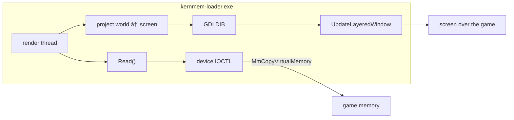

# In-game overlay

The overlay is the part that proves the whole chain works. It draws **your** position, **your attack range**, and enemy heroes with health and distance, over the live game — and it needs no injection, because every number it draws comes through the driver device.

---

## 1. What it is

A click-through, topmost, per-pixel-alpha layered window owned by `kernmem-loader.exe`, positioned over the game client's window.

| Property | Value | Why |
|----------|-------|-----|
| `WS_EX_LAYERED` + `UpdateLayeredWindow` | per-pixel alpha | transparent background, no black box |
| `WS_EX_TRANSPARENT` | click-through | mouse input still reaches the game |
| `WS_EX_TOPMOST` | above the game | survives the game repainting |
| `WS_EX_TOOLWINDOW` | no taskbar button | it is not an app |
| `WS_EX_NOACTIVATE` | never steals focus | typing in game is unaffected |
| GDI + 32-bit DIB | drawing | no DirectX device, no hook, no injection |
| F9 | hotkey | stops it from anywhere |

---

## 2. Data flow



There is no hook, no injected DLL, and no D3D present call. The overlay is a separate topmost window that happens to sit over the game.

---

## 3. Start it

From the menu (`o`), or from the CLI:

```powershell
.\dist\kernmem-loader.exe overlay
```

The loader starts `kernmem-league.exe` beside itself and stays resident, because the client reads through the loader's mapping. The CLI form blocks until the client exits; F9 in the client stops it.

---

## 4. What it draws

| Element | Meaning |
|---------|---------|
| green box + `YOU hp/maxhp` | you |
| cyan ring around you | your attack range, read live from the hero (700 on this build), projected into the world as 64 points |
| blue box | ally hero |
| red box | enemy hero |
| health bar above each box | current health fraction |
| `name distance` above each box | identity and range |
| thin line from you to each hero | who is in range of what |
| top-left status block | pid, base, fps, hero count, matrix/self state |

If the status block says `matrix MISSING` or `self null`, the overlay is running but the offsets are not resolving — see §6.

The attack range is read from the hero itself (`HeroAttackRange`), with the constant only as a fallback when the read misses — it is never assumed to be 550.

The radar is now only the fallback. It appears when the camera cannot be read, and it still draws the range ring, because a world radius there is just `range * scale` — no projection needed. With a camera, boxes and the world-space ring are the output and the radar is suppressed.

---

## 5. How positions become pixels

The camera is **two** matrices, 0x40 apart, both inline in the image and neither behind a pointer. The view goes first, then the projection, and only then the standard divide:

```
viewX = dot(world, viewColumn0) + view[12]   // and likewise for y, z
clip  = dot(view, projectionColumn)          // x, y, w
screen.x = (width  / 2) * (1 + clipX / clipW)
screen.y = (height / 2) * (1 - clipY / clipW)
```

They are applied one after the other rather than multiplied into a single 4x4 — composing them loses the depth the projection needs, while the sequential form reproduces the true camera depth exactly (a point 700 units out gives the expected pixel radius).

`clipW` is **negative** in front of this camera, because it looks down -Z, so the reject is `fabsf(clipW) <= 0.001f`. Testing `clipW <= 0` rejects the entire visible world.

Any point failing that, or producing a non-finite result, is dropped. The attack-range ring is 64 points around you in world space, each projected and the valid neighbours joined — so the ring curves correctly in perspective instead of being a circle drawn in screen space.

The offset is recovered, not memorised: scan for `48 8D 0D ? ? ? ? 0F 10 00` (`lea rcx,[rip+x]` / `movups xmm0,[rax]`). It hits once, and the LEA target is the view matrix itself. `scripts/find_viewmatrix.py` does that scan and proves the hit by projecting your own hero, which must land near screen centre because the camera follows you.

---

## 6. When it draws nothing

| Symptom | Cause |
|---------|-------|
| `heroes 0`, `self null` | not in a match — the object graph is null between games |
| `matrix MISSING` | the view-matrix offset moved on a patch — rerun `scripts/find_viewmatrix.py` |
| hero projects far off-centre | the game window is not focused, so it stops rendering and the camera freezes |
| boxes in the wrong place | position or matrix offset is stale |
| nothing at all, no window | game window not found; the overlay needs the client running |
| window appears but is black | DIB creation failed — check the log |

The offsets live in `league/client/offsets.h` and mirror `../scripts/offsets.py`. **Re-distil both together.** The client is a fast, dumb renderer; the Python side is where offsets are tracked and verified.

`scripts/verify_offsets.py` runs the loader's exact walk — same team enum, same two position distances, same validation — against the live process through the device, and prints what would be collected. Run it after any patch before trusting the overlay: a working run lists heroes with positions and health, a broken one lists none. It also tries the DOS path and the `GLOBALROOT` device path, so it doubles as a device check.

Two things about this build worth knowing. The object list is a **null-terminated inline array at the global**, so the local hero is an entry in it and must be skipped by address. And entries do not share one stat-block distance: some arrive 0x100 high, so the position is tried at `0x4584` then `0x4484` and a denormal or origin result is treated as a miss.

---

## 7. Performance

- One IOCTL per field read. A full frame is roughly `3 + 8n` calls, capped at `MAX_OBJECTS` (1024).
- 30 fps target (`Sleep(33)`); it is a status view, not a 240 Hz renderer.
- The DIB is only recreated when the client size changes.
- Alpha is stamped by OR-ing `0xFF000000` into every non-black pixel, because GDI leaves alpha at 0 and a layered window would otherwise show nothing.

---

## 8. Limits, stated plainly

- **Read-only.** It never writes, so it cannot desync the game.
- **No ESP for out-of-vision enemies.** `HeroVisible` is respected; fog-of-war entries are skipped.
- **Attack range is a constant**, not read from the hero — level and item modifiers are ignored.
- **No input, no aimbot.** It draws; it does not act.
- **x64 Windows 10/11 only**, like the rest of the project.
- **Offsets are unverified.** Expect to correct them on the first run.

---

Back to [index](README.md)
