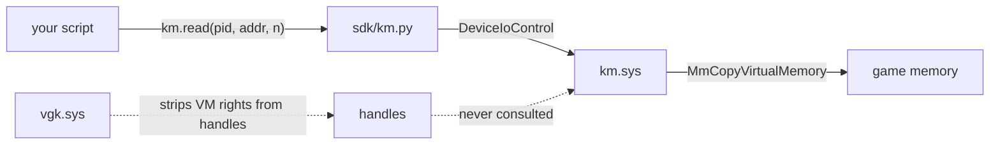

# Scripting against the driver

This is the document that answers the question the rest of the project raises: *if Vanguard strips handle access, how does a script read memory at all?*

---

## 1. The short answer

**A script never calls `ReadProcessMemory`.** It opens `\\.\Kernmem` and asks the driver, which copies memory kernel-side against the target `EPROCESS`. No handle to the game is involved, so the access mask Vanguard rewrites is irrelevant.



This is why the SDK exists. The `attach` path (handle restoration) is a bonus for tools that insist on the native API — it is not how a script should work.

---

## 2. Layers

| Layer | File | Role |
|-------|------|------|
| transport | `../../sdk/km.py` | IOCTL wrapper, chunking, version handshake |
| offsets | `offsets.py` | patch-stamped, confidence-tagged value table |
| reader | `reader.py` | resolves the client, walks chains, typed reads |
| demo | `demo.py` | `offsets` / `info` / `heroes` |

A real script sits on top of `reader.Game` and adds only game logic.

---

## 3. Minimal use

```python
from reader import Game

with Game() as game:
    print(hex(game.base))

    for hero in game.heroes():
        print(hero.name, hero.health, hero.visible)
```

`Game()` refuses to open when the client patch does not match the table. That is deliberate — see §5.

---

## 4. Offsets are the fragile part

Everything else is mechanical. The offsets are the part that breaks.

Each entry carries four things, and all four matter:

| Field | Why |
|-------|-----|
| `module` | an offset with no module is meaningless |
| `chain` | the dereference path, not just a final addend |
| `constant` | distinguishes a literal (a stride) from an address to dereference |
| `verified` | whether a human confirmed it against a live process |

`verified` is used honestly, and it does **not** mean "proven": `True` means the value is in the current dump *and* coherent against the other entries (the chain resolves, the type is plausible). A handful stay `False` because they were cited once or the shape was inferred. None has been confirmed against a live process by this project yet, so expect the first run to need adjustment.

`python demo.py offsets` prints the whole table with `UNV` marks so the gap is always visible.

### Filling them in

1. Scrape the thread with `../../tools/tempermonkey/post-download.js`.
2. Distil into `../research/unknowncheats/notes/<date>_<patch>.md` using the template.
3. Transcribe only the newest note into `offsets.py`; bump `PATCH` and `SCRAPED`.
4. Flip `verified=True` on a row **only** after it resolved correctly live.

---

## 5. Stale detection

`offsets.check_patch()` compares the running client's file version against `PATCH`. A mismatch raises `StaleOffsets` with the patch the table was scraped for, so the failure names the actual problem instead of surfacing as a null pointer twenty lines later.

`--allow-stale` overrides it for experimentation.

```
stale offsets: client is 14.24, table is for 14.23 (scraped 2026-11-15).
Re-distil from ../research/unknowncheats/notes/ or pass allow_stale=True.
```

---

## 6. Chain walking, and the zero rule

```python
def walk(self, entry, base=None):
    address = base or self._base
    for step in entry.chain:
        address = self.read_u64(address + step)
        if not address:
            return 0
    return address + entry.offset if address else 0
```

A zero pointer anywhere short-circuits to `0`. Callers treat `0` as "not available yet" instead of faulting — the game nulls most of this graph between matches, and a reader that raises on that is unusable.

---

## 7. Chunking

The driver caps a transfer at 64 KiB. `../../sdk/km.py` loops internally, so `read(pid, addr, 1 << 20)` works. Hand-rolled IOCTL callers must loop themselves.

---

## 8. What a script still has to handle

| Situation | Behaviour |
|-----------|-----------|
| Not in a match | `pid_by_name` returns 0, `Game()` raises |
| Match ended mid-run | reads start returning `STATUS_PARTIAL_COPY` |
| Game crashed | pid becomes stale, `STATUS_INVALID_PARAMETER` |
| Patch day | `StaleOffsets` |
| Driver unloaded | device missing, `KmError` on open |

`demo.py` maps each of these to a distinct exit code (2 stale, 3 offsets, 4 driver) so a wrapper script can react.

---

## 9. Performance notes

- One IOCTL per read. A `heroes()` pass costs one call per array slot plus eight per hero — fine at 1 Hz, wasteful at 100 Hz. Read the array in one 64 KiB chunk before the per-object calls if that matters.
- Read a struct once into a buffer and unpack locally rather than issuing a call per field.
- `MmCopyVirtualMemory` takes a reference and walks page tables each call; batching is the only real lever.
- Do not poll faster than the game writes, or you will read torn values.

---

## 10. What scripts do not get

- **Writes to read-only pages.** `.text` writes fail with `STATUS_PARTIAL_COPY`; reads are unaffected.
- **Handle-restored native access for a second process.** One registered client pid at a time.
- **Any injection.** This is a read/write interface, not a loader for DLLs.
- **Input.** Mouse/keyboard injection is a separate problem.

---

Back to [index](README.md)
