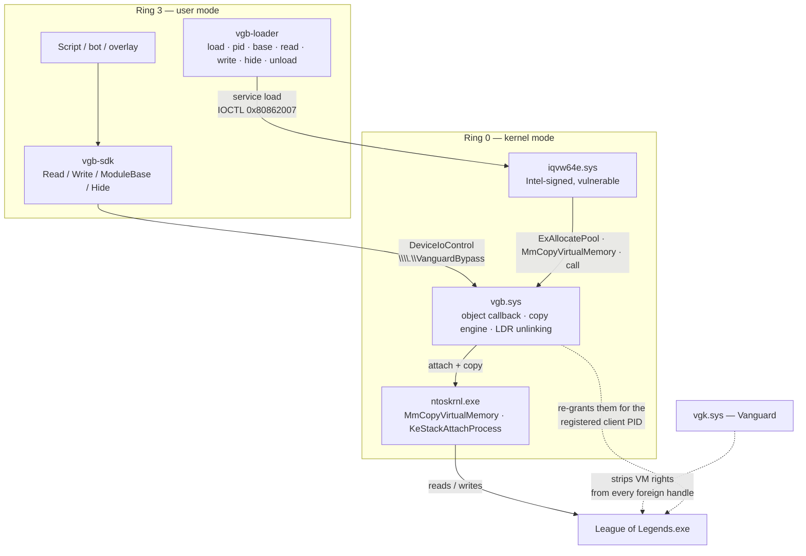
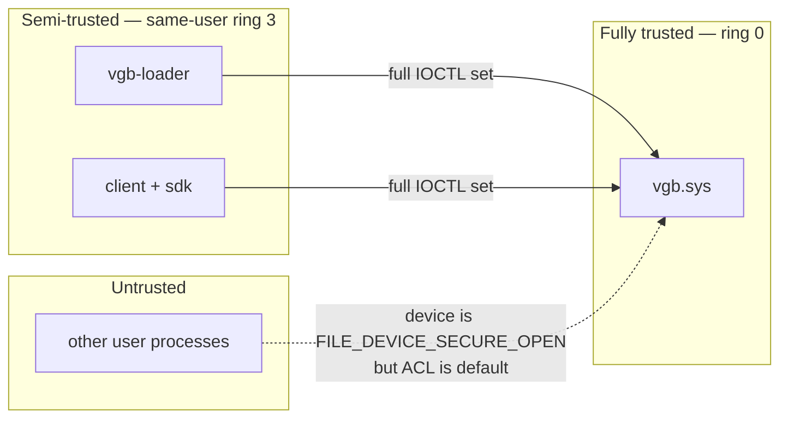
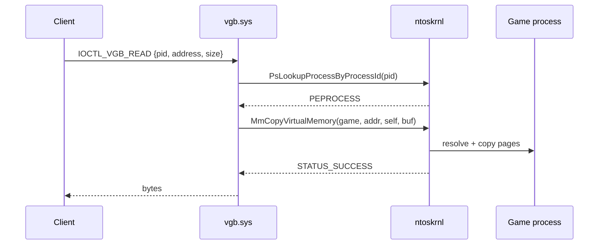
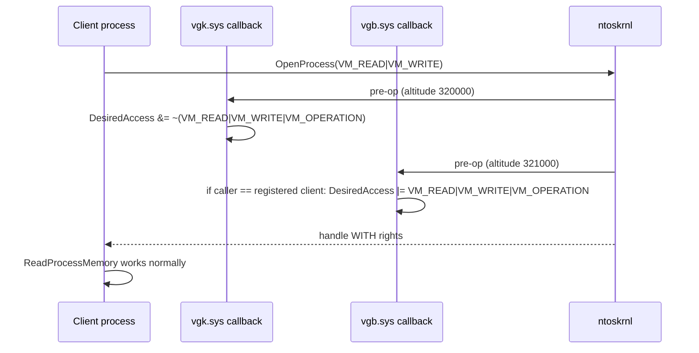
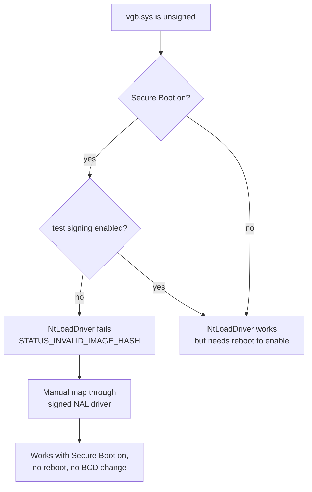

# 01 — Architecture

## 1. Why this shape

Vanguard runs in kernel mode and is loaded at boot. It protects the game process with an object callback, so **no user-mode-only design can work**: any handle your process opens to `League of Legends.exe` comes back with the VM rights removed.

Two conclusions follow, and the whole architecture is derived from them:

1. **Memory access must originate in kernel mode.** Either bypass the handle entirely (attach-based copy) or re-grant the rights on the handle.
2. **Our driver must get into the kernel without a signature.** Secure Boot is on and test signing is off on the reference machine, so `NtLoadDriver` on an unsigned image fails. A signed, vulnerable driver (Intel NAL) is used as the mapping host.

---

## 2. Component map



### Component responsibilities

| Component | Runs | Responsibility | Signature needed |
|-----------|------|----------------|------------------|
| `vgb.sys` | kernel | The bypass: copy engine, object callback, LDR unlinking, IOCTL surface | no (manual mapped) |
| `iqvw64e.sys` | kernel | Mapping host: gives kernel R/W and kernel calls | yes (Intel, already signed) |
| `vgb-loader.exe` | user | Loads `vgb.sys`, exposes a CLI, tears down cleanly | no |
| `vgb-sdk` | user | Thin typed wrapper so clients never build IOCTL buffers by hand | no |
| client | user | Actual cheat logic | no |

---

## 3. Trust boundary



The device object is created with `FILE_DEVICE_SECURE_OPEN`, and the symbolic link is `\DosDevices\VanguardBypass`. The default DACL lets any interactive user open it. **Anything that can open the device can read/write any process**, so the device is not a security boundary — it is a capability.

---

## 4. The two bypass paths

Both paths exist deliberately; they fail under different conditions.

### Path A — attach-based copy (primary)



No handle is opened by the client, so the object callback has nothing to modify. This path survives every version of the handle-stripping logic.

### Path B — handle restoration (secondary)



Our callback sits at a **higher altitude** (later in the chain) than Vanguard's, so it runs after Vanguard has stripped the mask and can put the bits back. This is what makes ordinary `ReadProcessMemory` usable from a script.

> Altitude ordering is the load-bearing detail. `321000` is chosen to sit above Vanguard's range. If Riot moves, this constant is the first thing to revisit.

---

## 5. Why the loader does not just call NtLoadDriver



Manual mapping also leaves **no service key and no loaded-module entry**, which is the point: the mapped image is invisible to `NtQuerySystemInformation(SystemModuleInformation)` and to `drivers\` enumeration.

---

## 6. Module hiding

Injected scripting DLLs are normally visible to Vanguard in three loader lists. `IOCTL_VGB_HIDE_MODULE` unlinks the entry from all three and re-initialises the list heads so the entry is self-consistent:

```
InLoadOrderModuleList          ──X──  entry
InMemoryOrderModuleList        ──X──  entry
InInitializationOrderModuleList──X──  entry
```

`IOCTL_VGB_UNHIDE_MODULE` re-inserts it at the head of each list, so unload order stays sane.

---

## 7. Design constraints accepted on purpose

| Constraint | Reason |
|-----------|--------|
| One client PID at a time | Keeps the callback decision O(1) and avoids a PID set to maintain. `IOCTL_VGB_SET_CLIENT_PID` is idempotent. |
| 64 KiB max transfer | Matches the METHOD_BUFFERED system buffer ceiling; larger reads are looped by the SDK. |
| No CRT in the driver | Manual mapping does not run the CRT initialiser, so no `/GS` cookie and no `memcpy` from the CRT. |
| No `PsGetNextProcess` import | Absent from this SDK's import library; resolved at runtime with a `ZwQuerySystemInformation` fallback. |

---

Next: [02 Detection model](detection-model.md)
