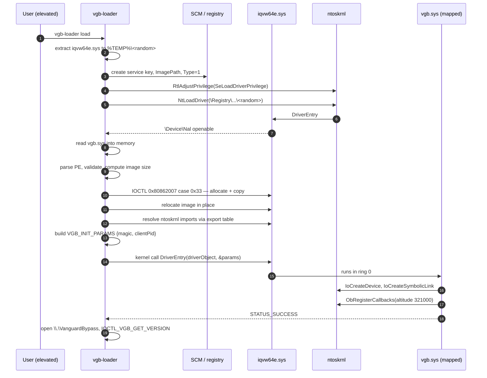
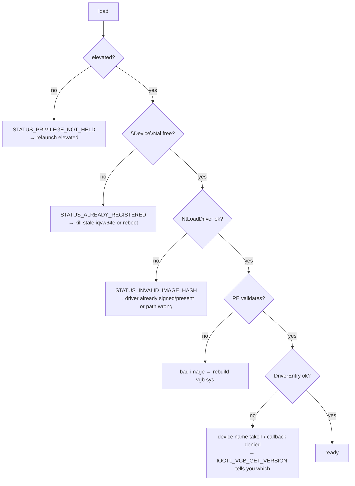
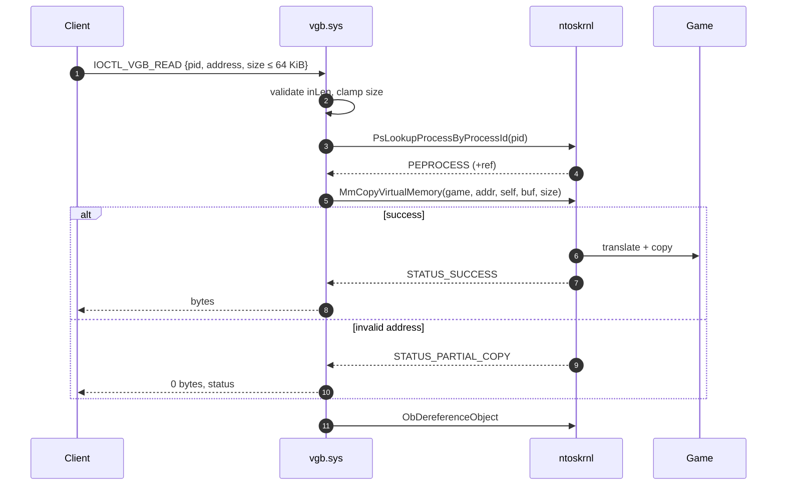
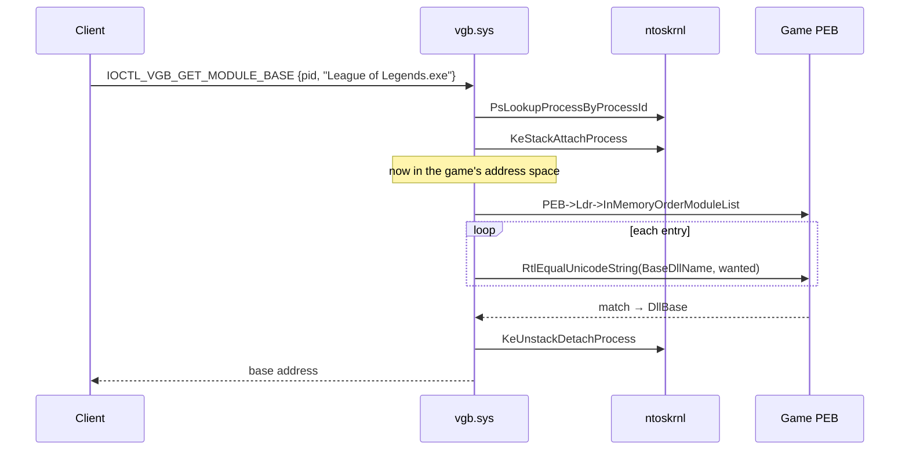
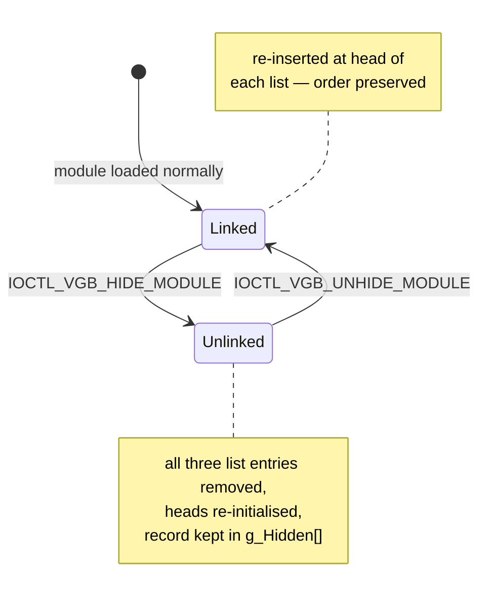
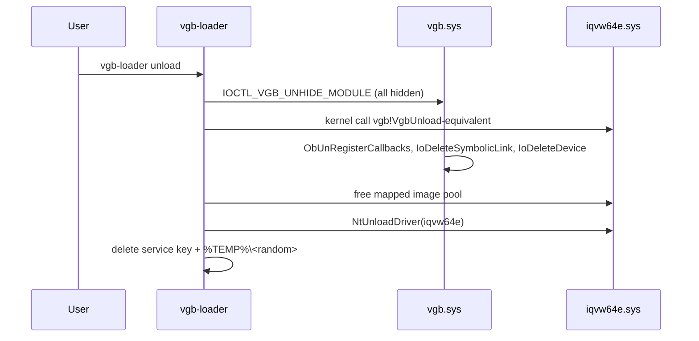
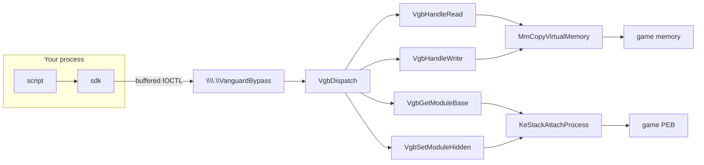

# 03 — Component flows

Every flow, in order, with its failure branches. This is the document to read when something breaks: each diagram has a matching entry in [06 Troubleshooting](troubleshooting.md).

---

## 0. Flow index

| Flow | Entry point | Ends at |
|------|-------------|---------|
| A | Load | `vgb.sys` running |
| B | Read | bytes in client buffer |
| C | Write | bytes in game memory |
| D | Module base | address of a module |
| E | Hide / unhide | LDR entry unlinked / relinked |
| F | Unload | kernel clean |

---

## A. Load



### Failure branches



**Invariant:** `vgb.sys` is never written to disk. It only ever exists in a kernel pool allocation. There is nothing to delete afterwards and nothing on disk for a scanner to find.

---

## B. Read



The client never opens a handle. If the read fails, it is an address problem, not a permission problem — a distinction that saves a lot of debugging time.

---

## C. Write

Identical shape with the operands swapped: the data block travels **after** the `VGB_MEM_REQ` header inside the same system buffer, and `MmCopyVirtualMemory` copies self → target.

```
+-------------------+---------------------------+
| VGB_MEM_REQ (24)  | payload (size bytes)      |
+-------------------+---------------------------+
  pid, size, address   copied into the game
```

Write to a read-only page (`.text` of the game) fails with `STATUS_PARTIAL_COPY` by default — expected, since `MmCopyVirtualMemory` honours page protection.

---

## D. Module base



`IOCTL_VGB_GET_MAIN_BASE` is the shortcut: `PsGetProcessSectionBaseAddress` returns the image base without a PEB walk.

---

## E. Hide / unhide



Order matters: unhide **before** `FreeLibrary`, otherwise the loader has no entry to remove and the process can fault on exit.

---

## F. Unload



Teardown runs in reverse order of setup, always. A partial teardown leaves `\Device\Nal` busy and the next load fails with `STATUS_ALREADY_REGISTERED`.

---

## G. Full data flow, one picture



---

Next: [04 Build and load](build-and-load.md)
