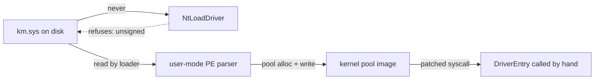
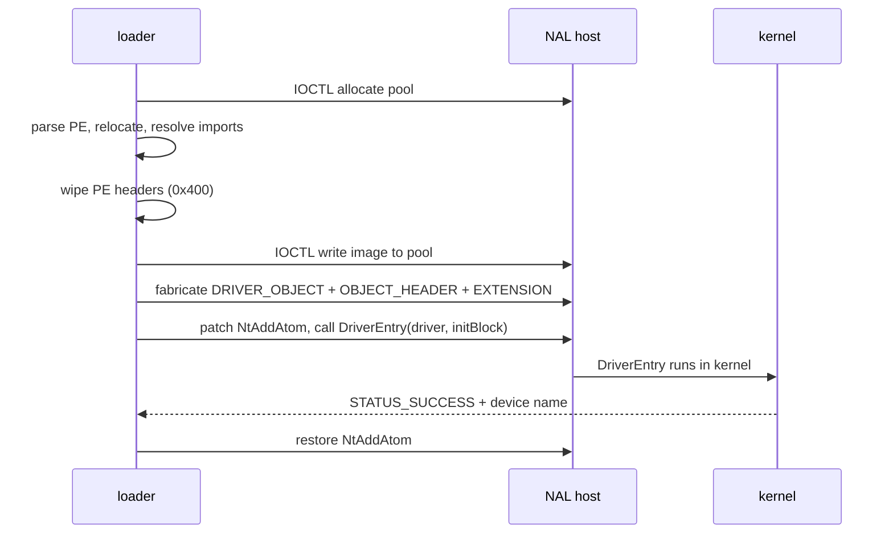
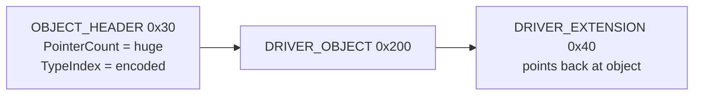
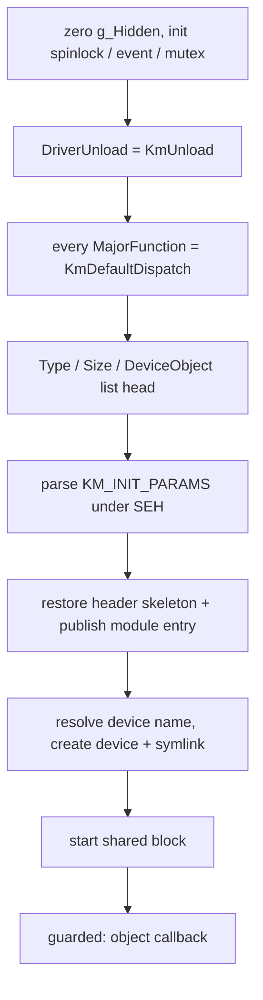
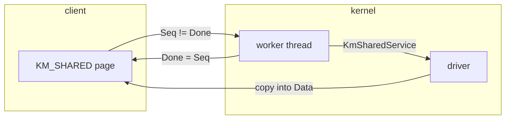
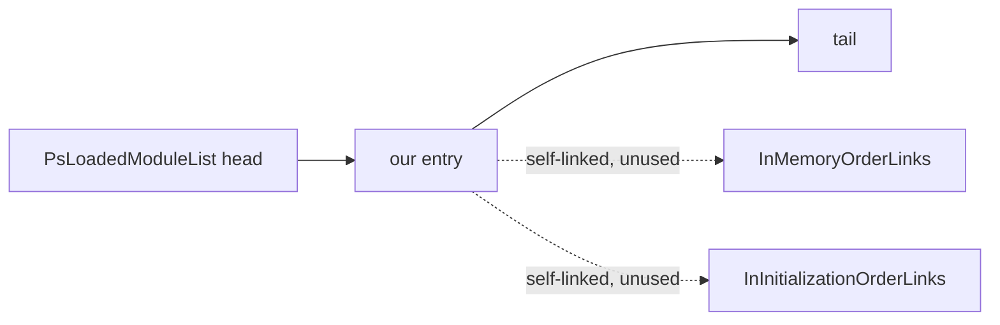
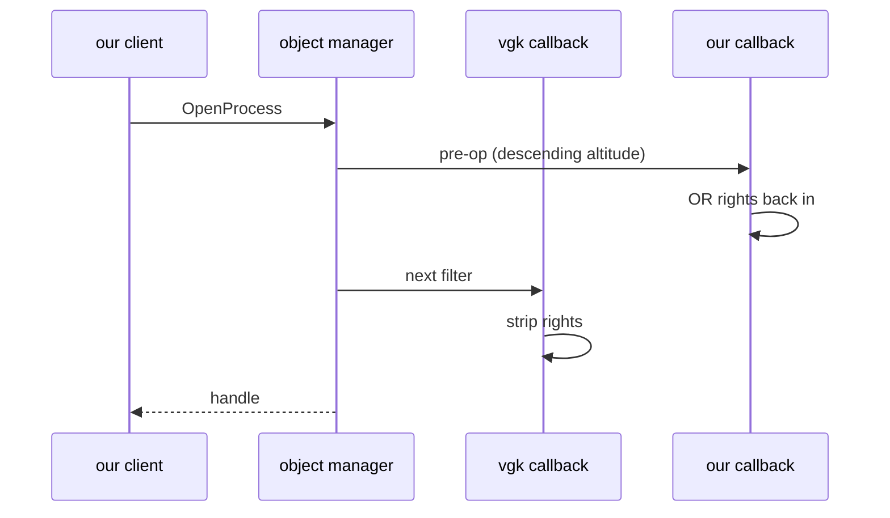
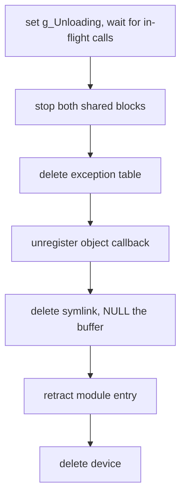

# 08 — Driver internals

> How `km.sys` actually works, end to end. Read `architecture.md` first for *why* the design is shaped this way; this page is the *how*.

Everything here is from the source. Line references are to `driver/main.c`.

---

## 1. The one constraint everything follows from

The image is **unsigned** and Secure Boot is on with test signing off, so `NtLoadDriver` refuses it. The only way in is **manual mapping** through a signed host driver (the Intel NAL driver), which means the kernel never properly "loads" us:

That single fact drives nearly every hazard in this file:

| Consequence | Where it is handled |
|---|---|
| No `DRIVER_OBJECT` is created for us | Loader fabricates one with a real `OBJECT_HEADER` (§3) |
| No `IRP_MJ_*` defaults are installed | `KmDefaultDispatch` fills every slot (§4) |
| The image is not in `PsLoadedModuleList` | Published by hand so enumeration agrees (§7) |
| The unwinder cannot find `.pdata` | Header skeleton restored + early publish (§6) |
| No service key, no file on disk | Trail hiding lives in the loader |

---

## 2. Load sequence

The loader does the dangerous parts; `DriverEntry` assumes a prepared world.

`DriverEntry`'s second argument is **not** a registry path under manual mapping — it is a pointer to `KM_INIT_PARAMS`. `KmLooksLikePointer` (`main.c:199`) only checks plausibility, and the magic is validated under SEH (`main.c:2388`).

`KM_INIT_PARAMS` carries: client pid, image base/size, altitude seed, pool tag, device name, shared block VA/size, and `.pdata` RVA/size.

---

## 3. The fabricated driver object

`IoCreateDevice` takes a reference on the `DRIVER_OBJECT` and `IoDeleteDevice` drops it. A bare pool block has no header, so the reference would land in `DriverStart` and the drop would underflow — **bugcheck `0x18 REFERENCE_BY_POINTER`**.

The loader therefore allocates `OBJECT_HEADER (0x30) + DRIVER_OBJECT (0x200) + DRIVER_EXTENSION (0x40)` as one block:

- `PointerCount` is parked enormous so the kernel never removes the object; the pool belongs to us.
- `TypeIndex` is never stored raw — `ObGetObjectType` decodes `stored ^ ObHeaderCookie ^ (Header >> 8)`. The loader recovers the real cookie from `IoDriverObjectType`'s own header and inverts the formula, then reads it back to verify (`mapper.cpp:321-414`).
- A NULL `DriverExtension` is dereferenced by several kernel paths, hence the back-pointer.

---

## 4. Entry point, in order

`DriverEntry` (`main.c:2332`) is ordered so nothing can fault before its guard is up.

`KmDefaultDispatch` (`main.c:2085`) exists because `NtLoadDriver` normally fills unset slots with `IopInvalidDeviceRequest`. A mapped image gets nothing, so a stray `IRP_MJ_SHUTDOWN` would dispatch to address `0` — `0x7E`/`0x8E`.

---

## 5. Shared block — the fast path

Polling IOCTLs from an overlay means a syscall per read, and a patched `NtAddAtom` stays live for each. The shared block removes both.

**Layout** (`km_shared.h:150-174`): magic, slot count (32), data size (`0x20000`), `Ready`, heartbeat, `Reqs[32]`, `Data`. Total ≈ 33 pages (`0x21`) — which is exactly the `0x76 PROCESS_HAS_LOCKED_PAGES` parameter.

**Protocol:** client sets `Seq`, worker services, worker writes `Done = Seq` last. No lock needed on the client side; it spins on `Seq == Done`.

**Two blocks** (`KM_BLOCK_KERNEL 0`, `KM_BLOCK_CLIENT 1`) so a client cannot read or overwrite the loader's slots. One worker serves both, started with the first and stopped with the last.

### Why the MDL handling is delicate

`MmProbeAndLockPages` locks as it walks and **raises partway** on a page it cannot lock. Freeing the MDL there without `MmUnlockPages` leaves those pages charged to the process forever — `0x76`, 33 pages. The handler unlocks under its own nested SEH before freeing (`main.c:352-373`), and `KmAddressCopyable` screens kernel-range addresses first, because that copy has no probe behind it.

---

## 6. Making `__try` work at all

The unwinder finds an image's `.pdata` by looking the RIP up in `PsLoadedModuleList`, then reading that image's PE header. A mapped image has neither, so `RtlLookupFunctionEntry` returns NULL and **every `__try`/`__except` escalates to `0x1E`**.

`RtlAddFunctionTable` would fix it directly — except **ntoskrnl does not export it** on current builds (only `RtlLookupFunctionEntry`). So two things are done instead, both before any risky code:

1. **`KmRestoreExceptionHeader`** (`main.c:2147`) writes back `MZ`, `e_lfanew`, `PE`, machine, PE32+ magic, `SizeOfImage`, `NumberOfRvaAndSizes` and only the EXCEPTION directory — enough for `RtlImageDirectoryEntryToData` to reach `.pdata`, not a full header a pool scan would spot.
2. **`KmPublishModuleEntry`** runs immediately after, so the RIP lookup can find the image at all.

Registration via `RtlAddFunctionTable` is still attempted as an extra, resolved through `MmGetSystemRoutineAddress`, and is harmless when absent.

---

## 7. Module list publishing

`KmPublishModuleEntry` (`main.c:2132`) builds a real `KLDR_DATA_TABLE_ENTRY` in `NonPagedPool` with a 0x10 reserved prefix, and inserts **only** `InLoadOrderLinks`:

Linking the same entry into all three lists made every walker read it `0x10` bytes off. `HashLinks` is asserted at `0x70` (`C_ASSERT`, `main.c:75`).

> `PsLoadedModuleList` is a **data import**, so `&PsLoadedModuleList` addresses the IAT slot, not the list head. Dereferencing the slot once yields the real head (`main.c:2249`).

---

## 8. Handle restoration

Vanguard strips `PROCESS_VM_READ/WRITE/OPERATION` from every handle. Our pre-operation callback (`main.c:1420`) runs at a **higher altitude** so it can OR them back in afterwards.

Altitude is seeded per install (`330000 + seed % 60000`) with historical fallbacks behind it, because a fixed altitude is both a constant to signature and a collision risk.

This is the **secondary** path. The primary is attach-based `MmCopyVirtualMemory`, which involves no handle at all, so a callback cannot touch it.

---

## 9. Teardown

`KmUnload` (`main.c:2229`) drains in dependency order, and **the entry failure path runs the same drain** — a returned failure lets the loader free the image while our worker still executes inside it.

The order matters: the table points into the image, the entry holds the name buffer, and the symlink must go before the device.

---

## 10. Comparison with kdmapper

kdmapper is the reference implementation for this technique and is vendored at `driver/research/kdm_src/kdmapper-master`. The two are not equivalent: kdmapper is a one-shot mapper, this is a runtime system. Stating where each is better is more useful than claiming parity.

| | kdmapper | here |
|---|---|---|
| Entry arguments | `NULL, NULL` (`main.cpp:203`) - no `DRIVER_OBJECT` | fabricated object, so `IoCreateDevice` and callbacks work |
| Exception table | none - no `RtlAddFunctionTable`/`PsLoadedModuleList` anywhere in its `kdmapper/` | header skeleton + early publish (section 6) |
| Module list | not published | published (section 7) |
| Allocation | `MmAllocateIndependentPagesEx` + `MmSetPageProtection` | `NonPagedPool`, executable, `+0x2000` slack |
| Host residency | unloaded immediately after the map | kept resident for the shared block |
| Device already present | refuses to load | attaches (section 2) |
| Target discovery | PDB offsets via `KDSymbolsHandler` | patterns, then shape scans |
| Trail hiding | none | sweep, relocation, path disguise |

**Taken from it:**

- **The unload record is suppressed, not scrubbed.** `ClearMmUnloadedDrivers` walks the handle table to its own device, follows `FILE_OBJECT -> DeviceObject -> DriverObject -> DriverSection`, and zeroes `BaseDllName.Length` so `MiRememberUnloadedDriver` skips the write. Nothing is guessed, so no candidate can be a false positive - which is what produced three bugchecks here. Offsets: object `+0x08`, device `+0x08`, driver `+0x28`, section `+0x58`. Its bounded `NtQuerySystemInformation` retry is used too, because the handle table grows between the sizing call and the real one.
- **PiDDBCacheTable by pattern**, resolved `(hit + 2, 6, 10)` - the same arithmetic it uses. The shape scan stays as a fallback and says so.

**Not taken:**

- **`NULL` entry arguments.** It has no way to create a device or register a callback, which is the whole basis of the Vanguard workaround.
- **Unloading the host.** Its exposure window is milliseconds; ours is a session. The shared block is the reason, and the trade is deliberate.

---

## 11. Hazard index

Every entry is a real fault this driver has taken, or a bug found while fixing one.

| Symptom | Cause | Guard |
|---|---|---|
| `0x76` / param `0x21` | MDL freed without unlock after a raised probe | unlock under SEH, `main.c:352` |
| `0x1E` at a `__try` | no `.pdata`, guard escalated | header skeleton + early publish |
| `0x18` | bare pool block as `DRIVER_OBJECT` | real `OBJECT_HEADER`, cookie |
| `0x1E` reading `-1` | unscreened kernel-range copy | `KmAddressCopyable` |
| `0x3B` in `RtlRbInsertNodeEx` | image copy into a zero-slack block | `+0x2000` slack, section bound |
| `0x50` in `memcpy` | bogus pointer treated as kernel | range screen first |
| `0x1E` on PEB read | process tearing down | `KmUserPointer` before every deref |
| `0x7E` / `0x8E` | NULL `MajorFunction` slot | `KmDefaultDispatch` everywhere |
| `0x50` writing a scrub record | canonical is not mapped; scan false positive | `Mapped()` before every write |
| `0x50` reading a name buffer | same, on the read path | `Mapped()` on descriptor and buffer |
| `0x50` in a scan chunk | one merged span read across non-writable gaps | per-section ranges |

---

## 12. Limits

- **Not a security boundary.** Anything with a kernel primitive can walk pool and find the image.
- **Pool is not executable-safe by default** — the loader asks for `NonPagedPool`, never `Nx`.
- **The host driver is still stock `iqvw64e.sys`.** Disguising the path does not change its bytes or its expired 2015 Intel signature; a hash match still lands.
- **Per-boot only.** Nothing survives a reboot; the loader re-establishes everything.
