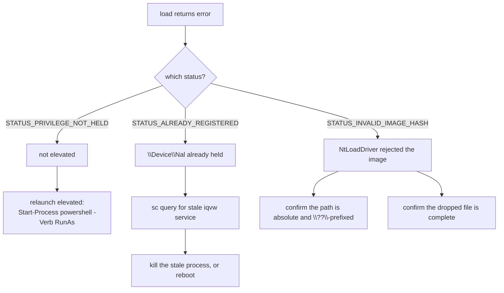
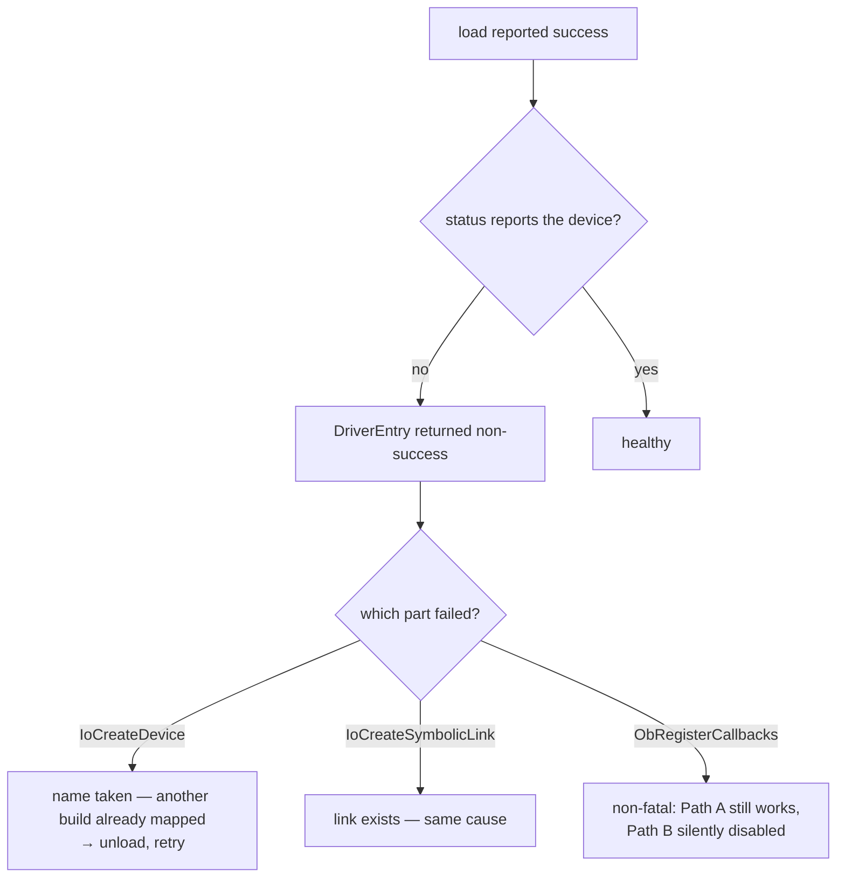
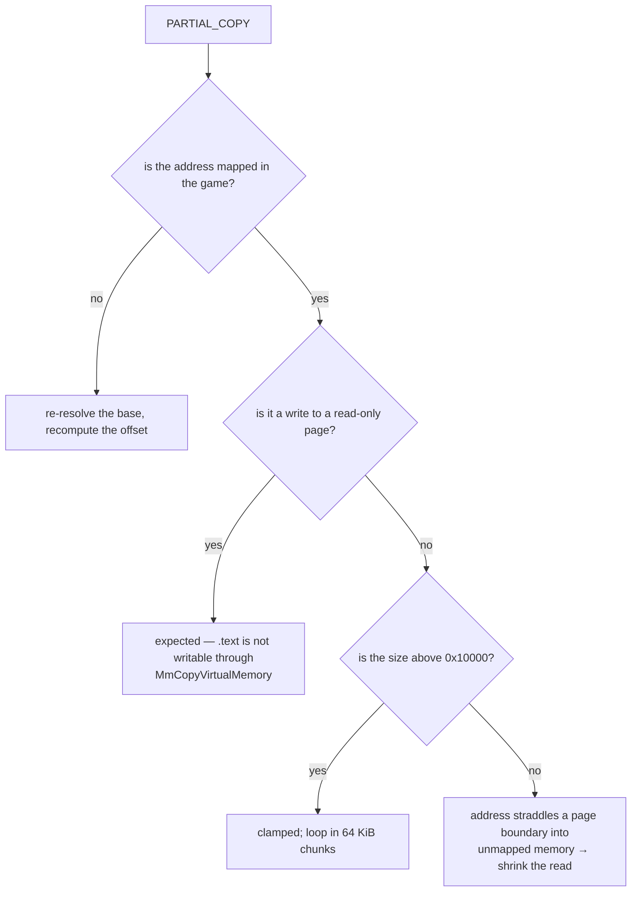
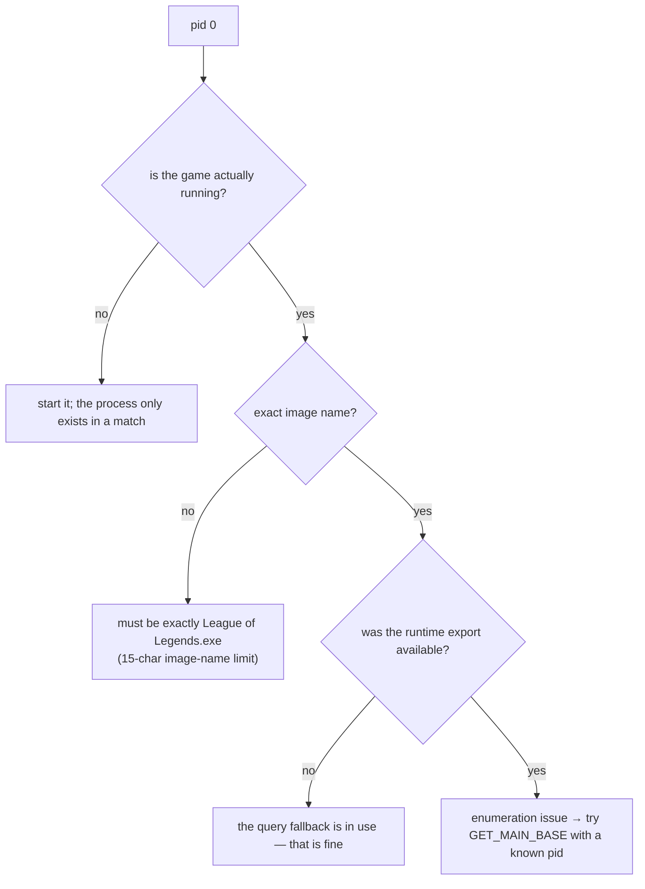
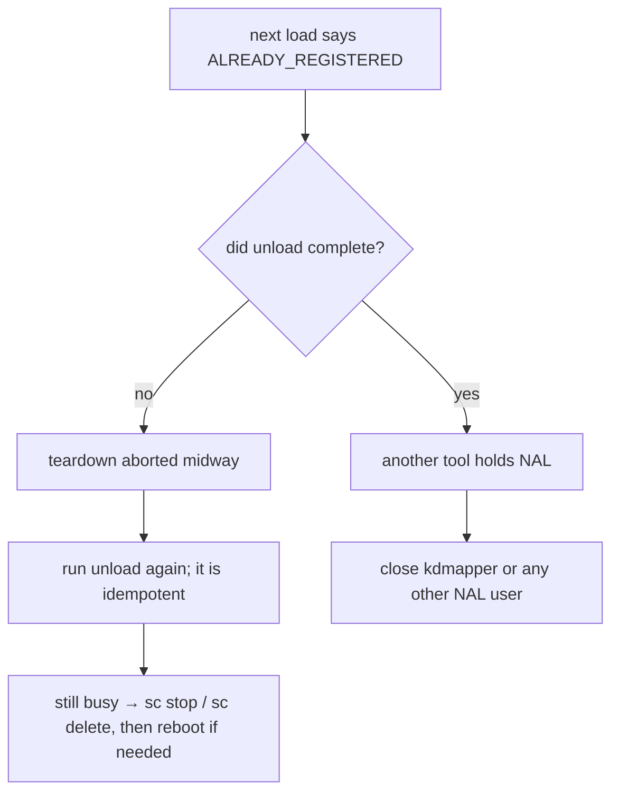

# 06 — Troubleshooting

Each tree maps to a numbered failure branch in [03 Component flows](component-flows.md).

---

## 1. `load` fails immediately



### Check whether NAL is already resident

```powershell
Get-Service | Where-Object Name -match 'iqvw|nal'
Get-Process | Where-Object Name -match 'vgb|kdmapper'
```

If a service key exists but no process does, a previous run crashed mid-teardown:

```powershell
sc.exe stop <name>
sc.exe delete <name>
```

---

## 2. `load` succeeds but the device is not there



`ObRegisterCallbacks` failing is **not** fatal by design; it only costs Path B. If `ReadProcessMemory` fails while the SDK read works, that is the signature of a denied callback — check the altitude.

---

## 3. Reads fail with `STATUS_PARTIAL_COPY`



A useful sanity check is reading the PE header at the image base — `MZ` at `base`, `PE\0\0` at `base + [base+0x3C]`. If that fails, the address is wrong, not the driver.

---

## 4. `ReadProcessMemory` fails but the SDK read works

That is Path B being off.

| Cause | Check | Fix |
|-------|-------|-----|
| Client pid not registered | `IOCTL_VGB_SET_CLIENT_PID` was never sent | send it from the working process |
| Callback not registered | DriverEntry returned non-success for `ObRegisterCallbacks` | check for an altitude collision |
| Altitude below Vanguard | rights stripped after we re-added them | raise the altitude above `320000` |
| Registered from another process | pid belongs to a different exe | re-register from the caller |

---

## 5. Game process not found



The kernel image name is truncated to 15 characters, so matching is on the prefix. `LeagueClient.exe` and `League of Legends.exe` are different processes — use the game one.

---

## 6. `unload` leaves `\Device\Nal` busy



Teardown is strictly reverse order: unhide → unregister callback → delete link → delete device → free image → unload NAL → delete key and file. Skipping a step is the usual cause.

---

## 7. Blue screens

| Bugcheck | Likely cause |
|----------|--------------|
| `0x50` `PAGE_FAULT_IN_NONPAGED_AREA` | dereferencing a bogus pointer outside `__try` |
| `0x3B` `SYSTEM_SERVICE_EXCEPTION` | PEB walk without `KeStackAttachProcess` |
| `0x8E` `KERNEL_MODE_EXCEPTION_NOT_HANDLED` | unguarded dereference in the dispatch path |
| `0xC4` verifier | pool misuse — check alloc/free pairing |
| `0x7E` | missing `.pdata` for `__try/__except` |

Crash dumps live in `%SystemRoot%\MEMORY.DMP` or `%LOCALAPPDATA%\CrashDumps`. Load in WinDbg and run `!analyze -v`.

---

## 8. Version skew

`STATUS_INVALID_DEVICE_REQUEST` on a call that used to work means the loader and driver disagree about the IOCTL table. `GET_VERSION` exists to catch this before real work. Rebuild both from the same tree — the root build refuses to package a diverged shared header.

---

## 9. Diagnostic ladder

Run in order and stop at the first failure:

```powershell
.\dist\vgb-loader.exe status                 # device present? version?
.\dist\vgb-loader.exe pid League of Legends.exe
.\dist\vgb-loader.exe mainbase <pid>
.\dist\vgb-loader.exe read <pid> <base> 2    # expect 4D 5A
.\dist\vgb-loader.exe attach <your pid>
.\dist\vgb-loader.exe read <pid> <base> 2    # now also via ReadProcessMemory
```

---

Next: [07 Production checklist](production-checklist.md)
